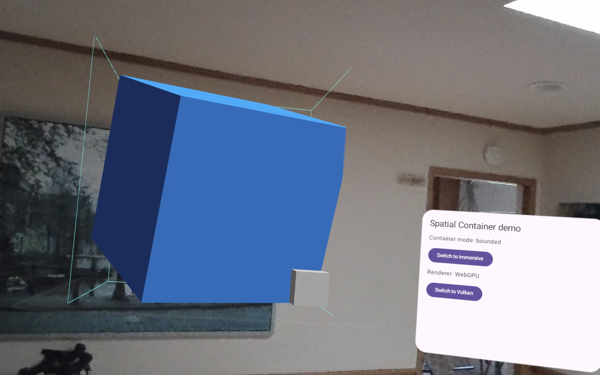
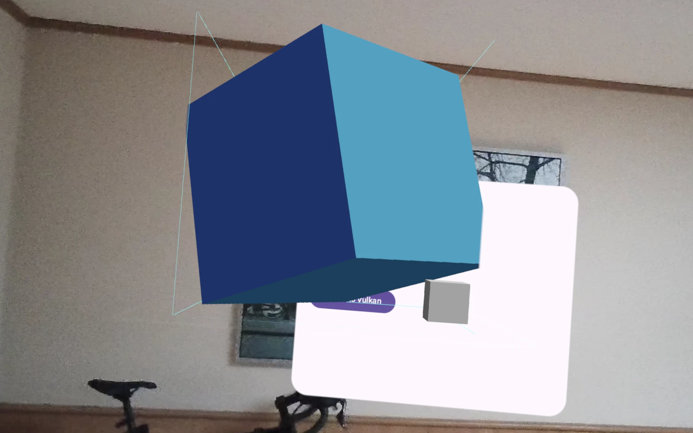

# OpenXR Spatial Container on Android XR — showcase

A native Android XR sample that renders 3D content inside an **OpenXR spatial container**
(`XR_EXT_spatial_container`) next to **Jetpack Compose for XR** panels. You can render it with
either of two GPU backends and switch between them while the app runs:

- **WebGPU** through [Dawn](https://dawn.googlesource.com/dawn), into an Android surface swapchain.
- **Vulkan** directly, through `XR_KHR_vulkan_enable2`, with runtime-owned colour and depth swapchains
  and `XR_KHR_composition_layer_depth`.

The scene is a rotating cube and the container's bounds as a wireframe. A white cube switches the
container between **bounded** and **immersive** mode when you point at it and pinch. A Compose XR
panel shows the current mode and backend and has buttons for both switches.



*The OpenXR spatial container in bounded mode, next to the Compose XR control panel, on an XREAL
Aura. Both render correctly when they don't overlap.*

## Requirements

- An Android XR device that supports `XR_EXT_spatial_container`. It was tested on the XREAL Aura.
- Android Studio with the NDK and CMake 3.31.6. `glslc` comes from the NDK's `shader-tools`.
- Git and Python 3. The first native build clones Dawn (`chromium/7999`, about 700 MB) and the few
  third-party libraries it needs into `app/third_party/`. Later builds reuse that checkout.

## Build and run

```bash
./gradlew :app:installDebug
```

Then follow the logs:

```bash
adb logcat -s SCDemo
```

## How it works

```
MainActivity (Compose XR, Full Space Managed)
 ├─ SpatialPanel            → ControlPanel: bounds mode + renderer toggles
 └─ SpatialActivityPanel    → ContainerActivity (1×1 dp, hidden)
                                └─ native render thread: XrApp + Renderer
```

- **Two activities.** On Android XR, when an activity renders through OpenXR, its 2D window is
  replaced by a gray placeholder, along with its Compose panels. So `MainActivity` stays a plain
  Compose XR activity. It hosts `ContainerActivity` in a `SpatialActivityPanel`, and that activity
  runs the OpenXR container.
- **`XrApp`** ([`xr_app.cpp`](app/src/main/cpp/xr_app.cpp)) owns the OpenXR instance, session,
  container, input actions and frame loop. The session is never begun: frames follow
  `XR_EXT_spatial_container_self_rendering` and `shouldSubmitLayers`.
- **`Renderer`** ([`renderer.h`](app/src/main/cpp/renderer.h)) is the backend interface. It owns the
  GPU device, the graphics binding and the swapchains. The graphics binding is fixed when the
  session is created, so switching backend restarts the session.
  - [`webgpu_renderer.cpp`](app/src/main/cpp/webgpu_renderer.cpp) uses Dawn on Vulkan, rendering
    into an `XR_KHR_android_surface_swapchain`. OpenXR needs a GL ES binding to create the session,
    so a small EGL pbuffer context supplies it. Surface swapchains only carry colour, so this
    backend has no layer depth.
  - [`vulkan_renderer.cpp`](app/src/main/cpp/vulkan_renderer.cpp) uses Vulkan 1.1 with colour and
    depth swapchains. It chains `XrCompositionLayerDepthInfoKHR` to every projection view.
- **Shared scene** ([`scene.cpp`](app/src/main/cpp/scene.cpp)): geometry, animation, eye matrices
  and uniform packing. Both backends upload the same bytes and draw the same slots. WGSL shaders live
  in the WebGPU renderer. Their GLSL equivalents are in [`shaders/`](app/src/main/cpp/shaders) and
  are compiled to SPIR-V at build time.

## Known limitation

The Android XR compositor draws the spatial container **over** Compose XR panels whatever their
distance.



*Here the Compose XR panel is in front of the container, closer to the viewer. It should hide the
lower part of the cube, the white toggle cube and the wireframe. All three are drawn over the panel,
which covers its "Switch to Vulkan" button.*

The compositor doesn't use depth to sort the container's layer against system panels. It always
puts the container's layer on top. We checked whether our depth submission was at fault:

| Backend | Swapchains | Layer depth (`XR_KHR_composition_layer_depth`) | Panel in front of the container |
|---|---|---|---|
| WebGPU (Dawn) | Android surface swapchain, colour only | not submitted | overdrawn by the container |
| Vulkan | runtime-owned colour (`R8G8B8A8_UNORM`) and depth (`D32_SFLOAT`) | submitted on every frame (near 0.05 m, far 100 m) | overdrawn by the container |

The Vulkan backend submits depth exactly as the OpenXR specification describes, and the result is
the same as without depth. So the cause is on the platform side, not in the app. Until the platform
fixes it:

- Place Compose XR panels **beside** the container, not in front of it, as in the first screenshot.
- Or draw the UI inside the container yourself, so it is depth-tested with the 3D content.

## License

Apache 2.0. See [LICENSE](LICENSE).
